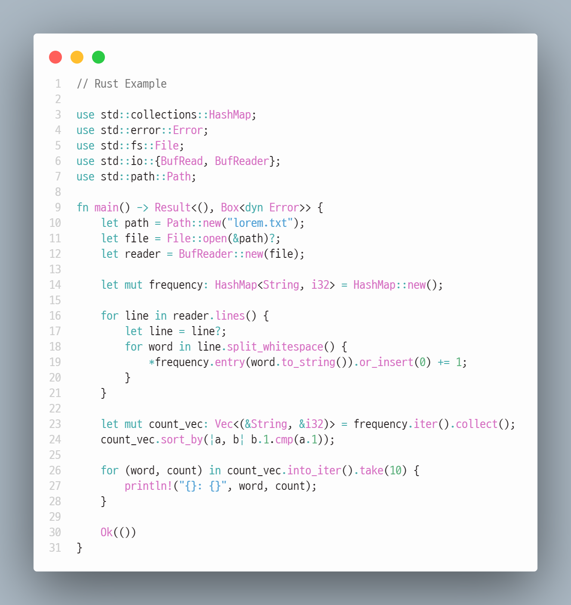
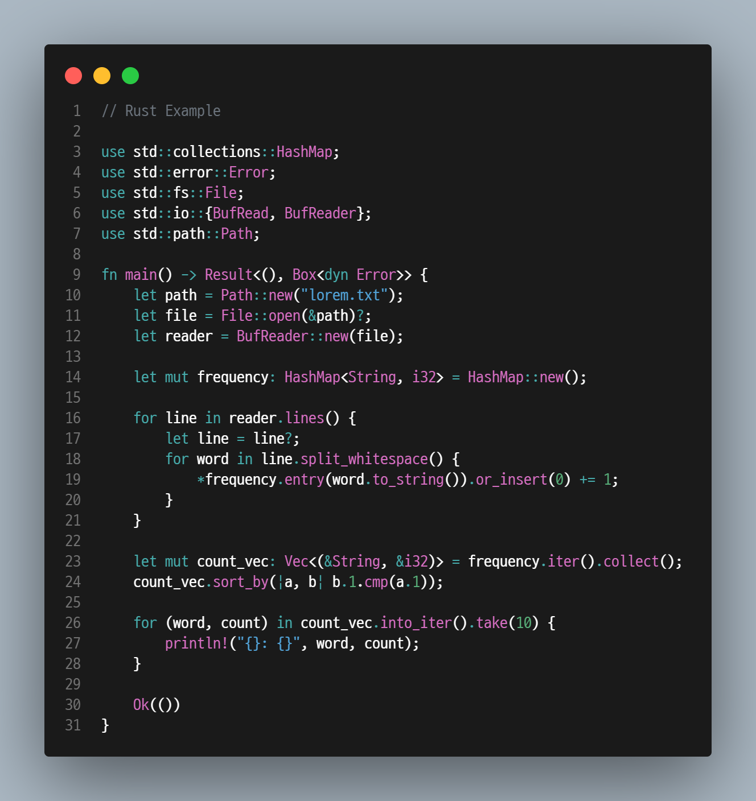

# Rhodes Theme

An Arknight inspired color theme for VS Code.

## Example

There is more example in `images` folder.

## Zed

Zed version lives in [zed/rhodes.json](./zed/rhodes.json).

Install it like this:

1. Copy `zed/rhodes.json` into `~/.config/zed/themes/rhodes.json`.
2. Restart Zed or reload the window.
3. Open theme selector and choose `Rhodes Dark` or `Rhodes Light`.

## License

Originally based on [Min Theme](https://marketplace.visualstudio.com/items?itemName=miguelsolorio.min-theme).

[MIT License](LICENSE)

Icon is generated by ChatGPT Logo Creator, I won't claim any copyrights for it because it is generated by DALL-E.
